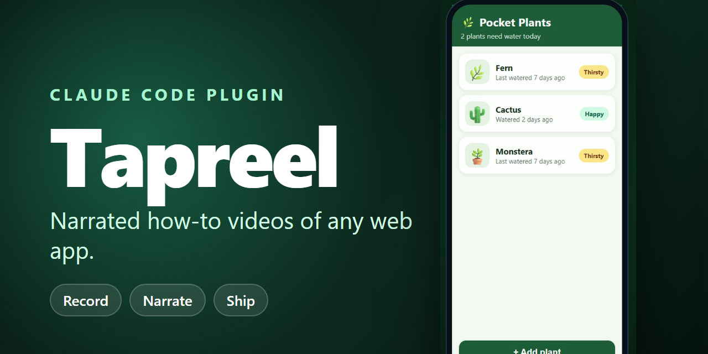
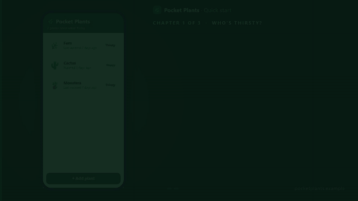

# Tapreel



**Narrated how-to videos of any web app.** Tap through the real app, add a natural-sounding voice, and ship a captioned film that looks and sounds hand-made.

Tapreel drives your app in a real browser (Playwright), records it, adds tap ripples and callouts, narrates every step with a local voice engine, and composes the finished video with chapters, captions, an intro and an outro with a QR code.

### See it
A 67-second sample film of an imaginary plant-care app, made entirely with Tapreel (voice, captions, recording, intro and outro):

[](docs/demo-pocket-plants.mp4)

[Watch the full film (mp4)](docs/demo-pocket-plants.mp4). The app, script and scenes behind it are in [`examples/pocket-plants`](examples/pocket-plants).

Status: 0.1.0. Web apps and PWAs, phone-shaped layout. Desktop-window layout, Electron and native apps are not supported yet.

## What you need
Tapreel asks before installing anything. If a required tool is declined, Tapreel cannot run.

| Tool | What for | Link |
|---|---|---|
| VoiceStudio | Local voice engine for the narration | https://github.com/debpalash/VoiceStudio |
| ffmpeg | Encoding, loudness | https://ffmpeg.org |
| Playwright | Operating and recording the app | https://playwright.dev |
| FilmCraft (optional) | Extra editing after the film is built | https://github.com/storytold/filmcraft |

## Install
```
/plugin marketplace add infinity20dragon-lab/tapreel
/plugin install tapreel@tapreel
```
Then, once, in the plugin folder: `npm install` and `npx playwright install chromium`.

## Use
From the root of the app you are filming:
```
tapreel init          # creates tapreel/ with a config, a script and a scene to edit
tapreel doctor        # what is missing?
tapreel consent       # the app owner approves what the recorder will do
tapreel plan          # first timeline, from estimates
tapreel narrate       # render the voice
tapreel plan --freeze # lock the measured sentence lengths
tapreel plan          # final captions + timeline
tapreel record        # operate the app, scene by scene, in time with the voice
tapreel build         # compose the film
tapreel check         # transcribe the film and compare it with the script
```
(`tapreel` is `node <plugin>/bin/tapreel.mjs`.) As a plugin, ask your coding assistant for "a how-to video of my app" and the `tapreel-make` skill walks through it.

## Permissions and safety
The recorder operates a real app, so:
- It signs in only with a **demo account** that you confirm is a demo account. The account name and password come from environment variables, never from files.
- It can reach **only the sites you list** in `access.allowedOrigins`; everything else is blocked. An entry is a site, not a page: `https://app.example.com` covers every page on it, and `https://*.example.com` covers the site and all its subdomains. APIs, fonts and other hosts the app calls need their own entries (the recorder prints what it blocked).
- It never starts until **the app owner approves** the exact settings (`tapreel consent`). Changing the target, account or data policy needs approval again.
- If a walkthrough changes data, you say so (`access.dataChanges`) and supply `hooks.mjs` that snapshots and restores it.
- The screen is recorded, so sample names can be swapped on screen with `masks` in the config.

## Audio quality rules
No stretched or cut audio, breath and stray-noise rejection, a frozen timeline so re-narrating never moves the footage, transcript checks and -16 LUFS loudness. See `skills/tapreel-qa`.

## License
MIT
